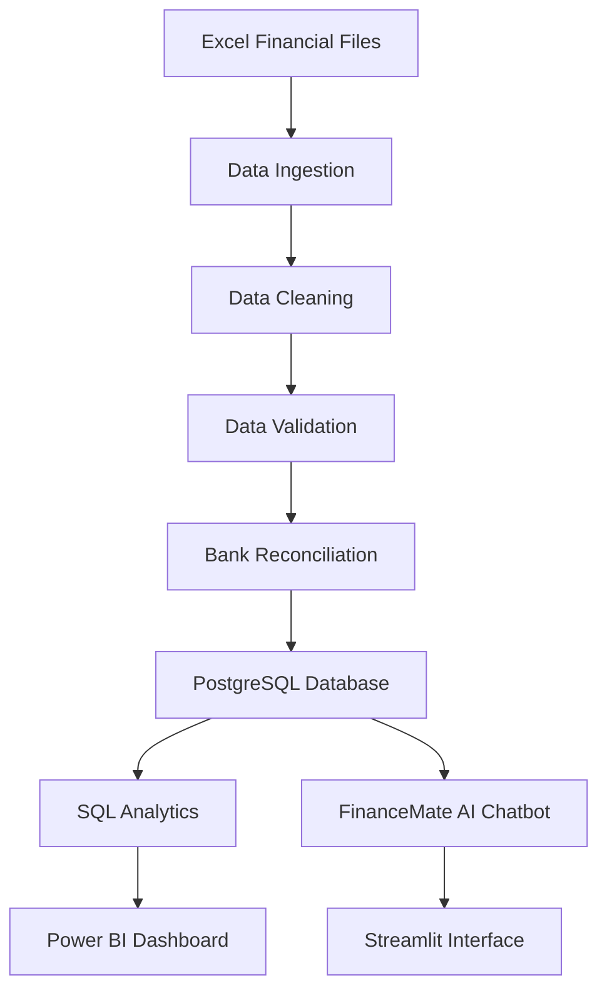

# 💰 FinanceMate AI

### Financial Intelligence & Audit Automation System

FinanceMate AI is a Python-based financial analytics and audit automation project that helps businesses process financial data, identify data quality issues, reconcile bank transactions, analyze financial performance, and interact with financial information through a chatbot.

The project combines **Python, Pandas, PostgreSQL, SQL, Streamlit, and Power BI** to demonstrate a practical financial data pipeline.

> Built as a portfolio project to demonstrate Data Engineering, Data Analytics, SQL, data quality validation, financial reconciliation, and dashboard development.

---

## 📌 Project Overview

Financial data is often stored across multiple Excel files, including sales records, expense reports, and bank statements. Manually checking these files can be time-consuming and prone to errors.

FinanceMate AI automates several of these tasks through a structured data processing pipeline.

The system:

- Reads financial data from Excel files.
- Cleans and standardizes inconsistent records.
- Identifies invalid and duplicate transactions.
- Validates financial records.
- Reconciles company transactions against bank statements.
- Stores processed data in PostgreSQL.
- Generates financial insights using SQL.
- Provides a chatbot interface for querying financial information.
- Visualizes financial performance and audit results through Power BI.

---

## 🚀 Key Features

### 1. Financial Data Ingestion

- Reads sales, expenses, and bank statement Excel files.
- Uses Pandas and OpenPyXL for data ingestion.
- Supports structured financial data processing.

### 2. Data Cleaning

- Standardizes column names.
- Handles missing values.
- Converts dates and financial amounts.
- Detects duplicate transactions.
- Identifies negative amounts and invalid records.
- Separates accepted and rejected records.

### 3. Data Validation

- Checks required fields.
- Validates transaction dates and amounts.
- Detects duplicate transaction IDs.
- Generates validation reports.

### 4. Bank Reconciliation

- Matches company transactions against bank statement records.
- Identifies matched transactions.
- Detects amount discrepancies.
- Identifies unmatched company transactions.
- Identifies bank-only transactions.
- Generates reconciliation reports.

### 5. PostgreSQL Database Integration

- Stores processed financial data.
- Uses structured relational tables.
- Supports SQL-based financial analytics.
- Uses conflict-aware database loading.

### 6. Financial Analytics

- Total revenue
- Total expenses
- Net profit
- Department-wise expenses
- Category-wise expenses
- Monthly financial performance
- Top expenses

### 7. FinanceMate AI Chatbot

- Answers financial questions using PostgreSQL-backed services.
- Provides financial summaries.
- Shows department expenses.
- Displays top expenses.
- Summarizes reconciliation results.
- Identifies audit discrepancies.

**Note:** The current chatbot uses rule-based keyword matching to identify user questions. It is not an LLM-powered conversational AI system.

### 8. Power BI Dashboard

- Financial Overview dashboard
- Revenue, expenses, and profit KPIs
- Department-wise expense analysis
- Category-wise expense analysis
- Monthly financial summary
- Audit reconciliation dashboard
- Transaction status filters

---

## 🏗️ System Architecture



---

## 🛠️ Technologies Used

| Technology | Purpose                               |
| ---------- | ------------------------------------- |
| Python     | Data processing and application logic |
| Pandas     | Data cleaning and transformation      |
| OpenPyXL   | Excel file handling                   |
| PostgreSQL | Financial data storage                |
| SQL        | Financial analytics and reporting     |
| Psycopg    | Python-PostgreSQL connectivity        |
| Streamlit  | Chatbot user interface                |
| Power BI   | Financial dashboards                  |
| Git        | Version control                       |
| GitHub     | Project repository                    |

---

## 📂 Project Structure

```text
FinanceMate-AI/
│
├── app.py
├── requirements.txt
├── README.md
├── .gitignore
│
├── data/
│   ├── raw/
│   ├── processed/
│   └── reports/
│
├── sql/
│   ├── schema.sql
│   └── analytics.sql
│
├── powerbi/
│   └── FinanceMate_AI_Dashboard.pbix
│
└── src/
    ├── ingestion/
    ├── processing/
    ├── validation/
    ├── reconciliation/
    ├── database/
    │   ├── db_connection.py
    │   └── db_loader.py
    │
    └── assistant/
        ├── financial_service.py
        ├── query_handler.py
        └── test_financial_service.py
```

---

## 📊 Sample Financial Results

The project uses synthetic financial data for demonstration purposes.

| Financial Metric |     Amount |
| ---------------- | ---------: |
| Total Revenue    | ₹1,35,000 |
| Total Expenses   |   ₹90,000 |
| Net Profit       |   ₹45,000 |
| Profit Margin    |     33.33% |

### Reconciliation Results

| Reconciliation Status          | Transactions |
| ------------------------------ | -----------: |
| Matched                        |            4 |
| Amount Discrepancy             |            1 |
| Unmatched Company Transactions |            2 |
| Unmatched Bank Transactions    |            1 |
| **Total**                |  **8** |

### Sample Audit Findings

- REF103 contains an amount discrepancy between company records and the bank statement.
- REF003 and REF005 are unmatched company transactions.
- REF999 is a bank transaction without a corresponding company record.

These findings demonstrate how automated reconciliation can help identify transactions requiring further investigation.

---

## ⚙️ Installation and Setup

### Prerequisites

Install the following:

- Python 3.10 or later
- PostgreSQL
- Git
- Power BI Desktop
- Visual Studio Code

### 1. Clone the repository

```bash
git clone https://github.com/YOUR_USERNAME/FinanceMate-AI.git
```

Navigate to the project:

```bash
cd FinanceMate-AI
```

### 2. Create a virtual environment

```bash
python -m venv venv
```

Activate it on Windows:

```powershell
.\venv\Scripts\Activate.ps1
```

### 3. Install dependencies

```bash
pip install -r requirements.txt
```

### 4. Configure PostgreSQL

Create a PostgreSQL database named:

```sql
CREATE DATABASE financemate_db;
```

Execute the database schema:

```text
sql/schema.sql
```

Run the schema SQL file using pgAdmin or PostgreSQL.

### 5. Configure environment variables

Create a `.env` file in the project root:

```env
DB_HOST=localhost
DB_PORT=5432
DB_NAME=financemate_db
DB_USER=postgres
DB_PASSWORD=your_postgresql_password
```

Replace the password with your local PostgreSQL password.

**Never upload your `.env` file or database credentials to GitHub.**

### 6. Run the application

```bash
streamlit run app.py
```

Streamlit will provide a local URL, usually:

```text
http://localhost:8501
```

Open this URL in your browser.

---

## 💬 Example Chatbot Questions

Ask FinanceMate AI questions such as:

- What is our total revenue and profit?
- Which department spends the most?
- Show me the top expenses.
- Show reconciliation summary.
- Find bank discrepancies.
- Show monthly financial summary.
- Show category-wise expenses.

---

## 📈 Power BI Dashboard

The Power BI dashboard includes:

### Financial Overview

- Revenue KPI
- Expenses KPI
- Net profit KPI
- Department expense analysis
- Category expense analysis
- Monthly financial performance

### Audit Details

- Reconciliation status
- Matched transactions
- Unmatched transactions
- Amount discrepancies
- Transaction-level details
- Interactive filters

Open the Power BI file:

```text
powerbi/FinanceMate_AI_Dashboard.pbix
```

---

## 🔍 Business Use Cases

FinanceMate AI demonstrates how financial automation can help:

- Finance teams reduce manual Excel processing.
- Auditors identify transaction discrepancies.
- Analysts monitor financial performance.
- Businesses track departmental spending.
- Data engineers build reliable financial data pipelines.
- Organizations improve financial data quality.

This is a prototype using synthetic data, not a production accounting or auditing system.

---

## 🧠 Skills Demonstrated

- Python programming
- Data ingestion and transformation
- Data cleaning and validation
- Financial data analysis
- SQL queries and aggregation
- PostgreSQL database integration
- Bank reconciliation logic
- ETL pipeline development
- Streamlit application development
- Power BI dashboard development
- Git and GitHub

---

## 🔮 Future Enhancements

- AI-powered natural language financial queries.
- Excel report generation and export.
- Automated pipeline execution from the Streamlit interface.
- Scheduled financial data processing.
- Email alerts for audit discrepancies.
- Role-based access control.
- Advanced audit trail and logging.
- Cloud deployment.

---

## 👨‍💻 Author

**Kaif Ali Asgar Khan**

Information Technology Engineering Student

GitHub: [Kaifalikhan2k4](https://github.com/Kaifalikhan2k4)

---

## ⭐ Support

If you find this project interesting, consider giving the repository a star on GitHub.

---

*FinanceMate AI — Turning financial data into actionable insights.*
